# VPSForge v2.1

<p align="center">
  
  
  
  
  
  
  
</p>

> **An Interactive, Enterprise-Grade Hypervisor-like Terminal Manager for lightweight Linux (Ubuntu, Debian, Alpine, etc.) VPS containers powered by Incus.**

VPSForge transforms any standard Ubuntu host into an enterprise-ready, multi-tenant VPS virtualization node. By marrying **Incus** (system containers) with **BTRFS** Copy-on-Write storage, **iptables** NAT rules, **Caddy** auto-SSL reverse proxying, and **Traffic Control (tc)** bandwidth shaping, VPSForge provides the full isolation and features of a commercial hypervisor at near-zero virtualization overhead.

---

## ✨ What's new in v2.1.24

- **VPN** (menu 12 > 5): turn any VPS into a fast VPN with **Xray (VLESS + Reality)**. Your phone or PC goes online with the VPS's IP and speed, and the traffic looks like a normal HTTPS visit to `www.speedtest.net`, so it is hard to block or slow down. Each device gets its own **data limit (GB) and number of days** (or unlimited) and is switched off by itself when one runs out (checked every 5 minutes); renew it any time. Share a device with a **QR page** (QR code + "Copy link", works for 10 minutes) or its `vless://` link; the app (v2rayNG, Streisand, V2Box, v2rayN) shows the name `<server IP>-<VPS>-<days>-<GB>` by itself. Measured on a 1-CPU ARM server: about 3x faster than WireGuard (the CPU is the limit; more CPUs = more speed). Tested by `scripts/vpn-test.sh` on a real host.
- **Every menu option checked end to end on a real server** (and its tests brought up to date): `port-forward edit` really edits a rule (the old one comes back if the new one fails); VPS names follow exactly what Incus accepts and are checked as you type them; error messages in Port Forward stay on screen; Settings prompts default to the current values; `vpsforge ram` checks and verifies.
- **Changing a VPS's internal IP really changes it.** The card used to keep its old address on a running VPS (a hidden setting was removed while it ran); now the new address is checked on the card and inside the VPS, and a refused change leaves everything as it was. Swapping two VPSs' IPs goes through a spare address, and two VPSs sharing one IP are fixed for real (the one that truly holds it keeps it).
- **Safer updates.** Two updates can no longer run at the same time (a lock), and the installed version is recorded only after the new code is verified, so a rolled-back update never claims the new version.
- **Safer storage migration and uninstall.** The move to BTRFS never touches containers VPSForge did not create and finishes by itself if it was stopped half-way. `vpsforge uninstall` keeps the storage pool, bridge and images of an Incus that was on the server before VPSForge.
- **Reinstall recovery keeps the website.** If a reinstall is killed half-way, the restored VPS keeps its port forwards and its Caddy file.
- **Smaller fixes:** removing the last route of a second domain no longer leaves an empty block in Caddy; deleting a tunnel of a stopped VPS removes its login when the VPS runs again; a real 1 Mbit speed limit survives the monthly quota reset; free disk space no longer counts what a VPS already used twice; name-based SSH ports never fall on a numbered VPS's port and a port the server itself uses is refused; the VPS list and the forward list ask Incus once instead of once per VPS.
- **On purpose:** VPSs stay *privileged* so Docker, WireGuard and the VPN work inside them. Give a VPS only to people you trust with root on it.
- **Tested on a real Oracle ARM server:** `scripts/e2e.sh`, `scripts/ui-test.py` (every menu, no safe mode), `scripts/vpn-test.sh` and `scripts/space-test.sh`.

---

## ✨ What's new in v2.1

- **Sites from MY computer** (menu 12 > 4): open a site that runs on your own PC to the internet through a VPS, **without opening any port on your router**. Your PC connects *out* to the VPS and visitors come in through the same connection. Add several tunnels per VPS, then list, start, stop, edit or delete each one (or all of them) from one table. A port tunnel appears in Port Forward (menu 11) by itself and disappears when you stop it. See [6.6b](#66b-sites-from-my-computer-reverse-tunnels-menu-12--4).
- **One line on Windows.** The menu shows a single line to paste in PowerShell plus a password. It downloads the setup from the VPS and installs it: an SSH key, a hidden task that starts at every login and reconnects by itself, and a desktop icon that opens a small window showing ON or OFF with **On / Off / Delete** buttons (Delete removes the tunnel from that computer and its icon). Linux and macOS get a one-line loop too.
- **Safe to give to a friend.** Each tunnel gets its own limited login (`vftun<port>`): it can open that one port and nothing else (no shell, no other forwards, no unix sockets, no password use elsewhere). "New key" takes access back from anyone; deleting one tunnel leaves the others untouched.
- **The main server stays clean by itself.** A weekly tidy (cron) trims the system journal (200 MB cap), removes old kernels, clears the apt cache and deletes damaged or half-written backups. Deleting a VPS returns its space to the real disk, and `vpsforge uninstall` also restores the firewall rules it added.
- **Damaged backups and snapshots never stay.** Every export and snapshot is verified right after it is made; a bad one is deleted at once with the reason shown. Importing a backup over an existing VPS keeps the old one aside until the new one is complete.
- **Fewer Incus calls** (one `incus list --format json` instead of one call per VPS), so menus stay fast on weak servers. Caddy domain removal handles every site block of a file, and port-forward rules are validated (protocol, IPv4, port range, reserved ports 22/80/443).
- **Backups, copies and snapshots keep tunnels, ports and domains right.** Importing a backup under a new name gives it a new internal IP and SSH port, moves its forwards and Caddy routes to them, checks every domain block for conflicts, keeps the saved login, and marks each tunnel *active* only if its public side really came back (otherwise *stopped*). A copy gets a new tunnel key. Cloning never copies the source's tunnels. A failed or cancelled import can no longer remove the original VPS's SSH port or forwards. A backup file without its `.info` is read directly (its settings live inside the archive), and an import stopped while changing Caddy puts every Caddy file back.
- **A full code review and the fixes from it.** Six Opus reviewers and a Gemini review read the whole project; the confirmed problems were fixed and tested on a real server. Highlights: a VPS can no longer reach another VPS's SSH port over the bridge; a failed reinstall keeps the original's domains, forwards, traffic quota and SSH choice; the owner's own forwards to port 22 survive; disabled forwards stay disabled at every start; traffic quotas keep a monthly running total that a VPS restart cannot reset; deleting snapshots and changing the OS of selected VPSs now ask first (`REINSTALL`); a port-forward edit is validated before the old rule is removed; a new VPS never takes an address another VPS holds; the weekly tidy no longer runs the full startup. Every forwarded port (not only SSH) is now accepted only for traffic that comes from outside the bridge, so a VPS cannot reach another VPS's forwarded ports either; older unrestricted rules are removed automatically at the next start.
- **More fixes from a second independent review.** Removing one domain no longer deletes the VPS's other domains; forwards bound to the server IP and IPv6 traffic are isolated between VPSs too; a clone of a VPS without public SSH stays without it; a new login gets the VPS password; the backup export check allows for Incus staging the tarball; the weekly tidy leaves files younger than an hour alone; an interrupted import is cancelled in Incus; a failed replace-import brings the original's domains back live; uninstall works without Incus and keeps other Incus projects, pools and volumes; the host's IPv6 router advertisements are no longer disturbed.
- **Reviewed and tested.** Offline tests (`scripts/test.sh`, 99 checks) and real-server UI tests cover the tunnel feature, including "add two tunnels, delete one, the other keeps working".

---

## ✨ What's new in v2.0.0

- **Nothing is ever left half-done.** Creating, importing, cloning, backing up, snapshotting and reinstalling are guarded: if anything fails or is stopped (error, Ctrl-C, closed terminal, even `kill -9` or a power cut), the half-made VPS is removed completely (disk, RAM limits, IP, SSH port, firewall rules, proxy config) and you are told why. A reinstall keeps the original aside and puts it back if the new one cannot be finished.
- **Clean server.** Deleting a VPS removes its snapshots and firewall rules, offers to delete its backups, and returns the freed space to the real disk. `vpsforge uninstall` puts the whole server back as it was before VPSForge (packages included).
- **The last answer is the default** in every prompt (RAM/CPU/disk/network/traffic, OS, ports, domain, protocol, selection...), so *Enter, Enter, Enter* repeats what you did before. **`0` goes back one step**, not to the start.
- **One edit menu** for one, several or all VPSs. **More operating systems**: Ubuntu, Debian, Alpine (about 10MB RAM, ideal for weak servers), Rocky, Alma, Fedora, Arch, CentOS.
- **Domains made simple** (menu 12, Domains & Reverse Proxy): add a domain in 5 guided steps, see all domains in one list, test or remove them; Caddy changes are validated and rolled back if invalid.
- **Clone a VPS** (menu 13, option 13): an instant exact copy to experiment on.
- **Protected against Incus updates**: the tested Incus is paused from updating, `vpsforge selftest` checks that every Incus command VPSForge needs still works, and Incus is repaired automatically if it breaks or disappears.
- **Faster and lighter**: cached public IP, one-time setup, BTRFS pool sized to the server (with a directory-pool fallback), swap for very small servers, backups compressed with zstd.
- **Every function is its own file**, grouped in topic folders, with offline tests (`scripts/test.sh`), real-server tests (`scripts/e2e.sh`, `scripts/ui-test.py`) and a loader (`lib/load_vpsforge_lib.sh`).

---

## 📑 Table of Contents

1. [🚀 Quick Installation & Setup](#1--quick-installation--setup)
2. [🖥️ System Architecture Overview](#2-️-system-architecture-overview)
3. [🌐 Network Topology & Inter-VPS Isolation](#3--network-topology--inter-vps-isolation)
4. [🧭 Main Dashboard & Navigation Map](#4--main-dashboard--navigation-map)
5. [🔄 Container Lifecycle & Multi-Selection Engine](#5--container-lifecycle--multi-selection-engine)
6. [🛠️ Feature-by-Feature Deep Dive with Flowcharts](#6-️-feature-by-feature-deep-dive-with-flowcharts)
   - [6.1 VPS Creation Wizard (Menu 1)](#61-vps-creation-wizard-menu-1)
   - [6.2 VPS Deletion & Resource Cleanup (Menu 2)](#62-vps-deletion--resource-cleanup-menu-2)
   - [6.3 Container Reinstall & State Preservation (Menu 6)](#63-container-reinstall--state-preservation-menu-6)
   - [6.4 Resource Tuning & Live Modifications (Menu 7)](#64-resource-tuning--live-modifications-menu-7)
   - [6.5 Port Forwarding & Conflict Detection (Menu 11)](#65-port-forwarding--conflict-detection-menu-11)
   - [6.6 Domain Reverse Proxy & Auto-SSL via Caddy (Menu 12)](#66-domain-reverse-proxy--auto-ssl-via-caddy-menu-12)
   - [6.6b Sites from MY computer: reverse tunnels (Menu 12 > 4)](#66b-sites-from-my-computer-reverse-tunnels-menu-12--4)
   - [6.6c VPN: Xray VLESS + Reality (Menu 12 > 5)](#66c-vpn-xray-vless--reality-menu-12--5)
   - [6.7 Snapshots & Compressed Backups (Menu 13)](#67-snapshots--compressed-backups-menu-13)
7. [⚙️ Engineering Secrets & Core Algorithms](#7-️-engineering-secrets--core-algorithms)
   - [7.1 BTRFS Copy-on-Write & Instant Snapshots](#71-btrfs-copy-on-write--instant-snapshots)
   - [7.2 Automated Live Storage Migration](#72-automated-live-storage-migration)
   - [7.3 Network Traffic Quota Daemon & TC Throttling](#73-network-traffic-quota-daemon--tc-throttling)
   - [7.4 SSH 1-Click Repair & Native LXC Container Architecture](#74-ssh-1-click-repair--native-lxc-container-architecture)
   - [7.5 In-Place Auto-Update & Version Switcher](#75-in-place-auto-update--version-switcher)
8. [📂 Project File Directory & Module Structure](#8--project-file-directory--module-structure)
9. [🧠 AI / Developer System Reconstruction Guide](#9--ai--developer-system-reconstruction-guide)
10. [💻 CLI Command Reference](#10--cli-command-reference)

---

## 1. 🚀 Quick Installation & Setup

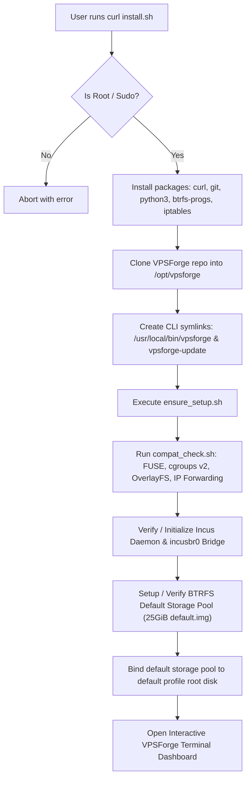

### One-Line Quick Install (Recommended)
```bash
curl -sSL https://raw.githubusercontent.com/ahmadElsharawy/VPSForge/main/install.sh | sudo bash
```

### Manual Installation
```bash
git clone https://github.com/ahmadElsharawy/VPSForge.git
cd VPSForge
sudo bash install.sh
```

### Version Update & Rollback
```bash
vpsforge update          # Upgrade to latest release / origin/main
vpsforge update v1.0.1   # Switch to specific release tag
vpsforge update --list   # List all available releases
vpsforge update --check  # Check update and synchronization status
vpsforge-update          # CLI alias wrapper
```

---

## 2. 🖥️ System Architecture Overview

VPSForge operates as a high-performance terminal control plane sitting on top of Linux kernel features and system daemons:

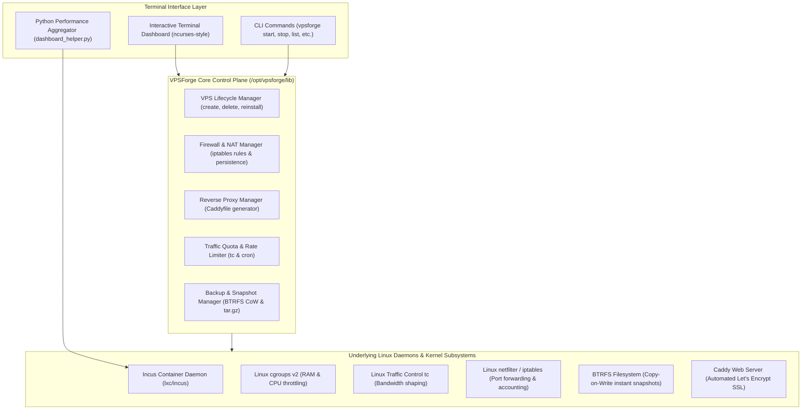

---

## 3. 🌐 Network Topology & Inter-VPS Isolation

Every container is assigned a static internal IPv4 address on the isolated subnet `10.135.30.0/24` with dedicated NAT routing for SSH (`9000 + N`) and custom services:

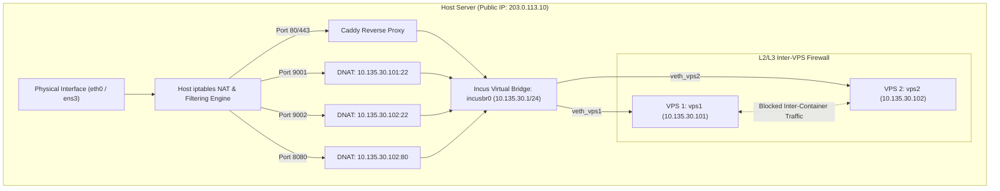

---

## 4. 🧭 Main Dashboard & Navigation Map

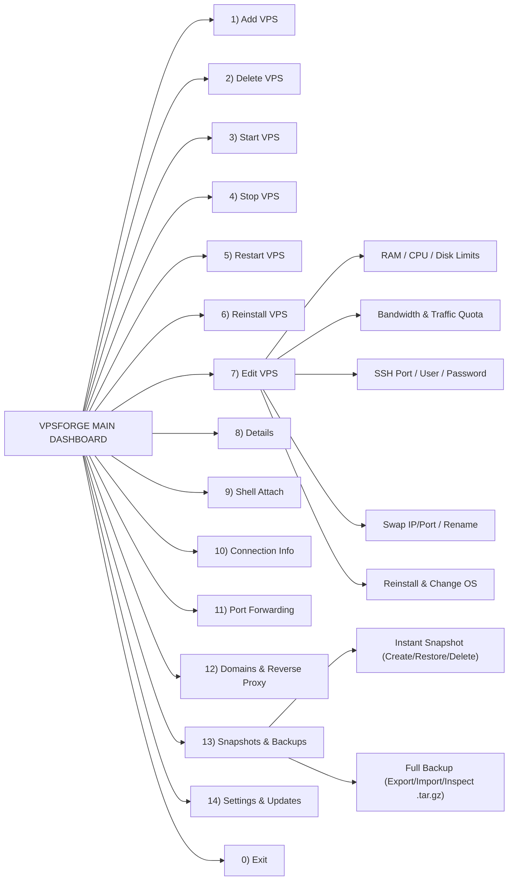

---

## 5. 🔄 Container Lifecycle & Multi-Selection Engine

### Container Lifecycle State Machine
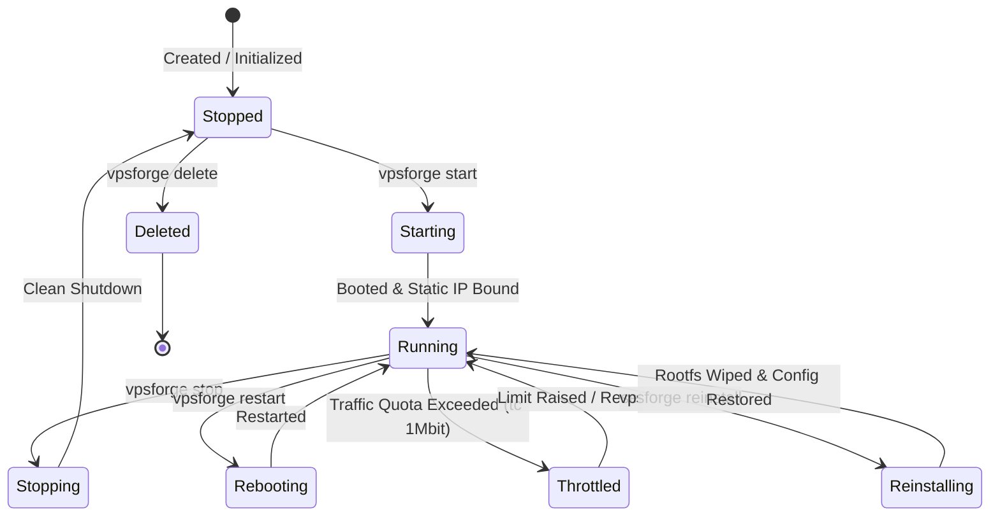

### Universal Selection Parser Flowchart
Any command or menu supports multi-input strings (e.g., `1-3,5,vps7,A`):

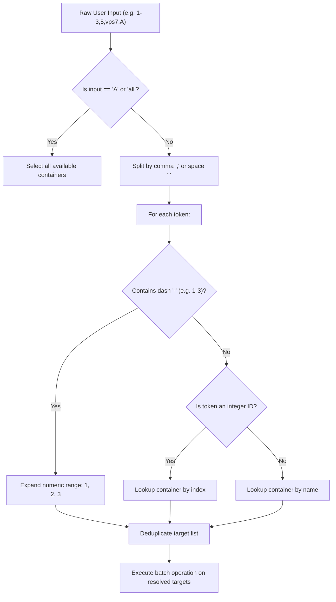

---

## 6. 🛠️ Feature-by-Feature Deep Dive with Flowcharts

### 6.1 VPS Creation Wizard (Menu 1)
```mermaid
flowchart TD
    StartCreate["Start VPS Creation"] --> PromptCount["Enter number of containers to create (Bulk support)"]
    PromptCount --> LoopVPS["For each container:"]
    LoopVPS --> AutoName["Generate unique name: vps1, vps2, ..."]
    AutoName --> FetchImages["Query Incus remote images:ubuntu and parse aliases"]
    FetchImages --> SelectImage["Choose OS: 24.04 (noble), 22.04 (jammy), cloud-init, etc."]
    SelectImage --> ResourcePrompt["Specify RAM (MB), CPU Cores, Disk (GB), Network Speed (Mbps)"]
    ResourcePrompt --> QuotaPrompt["Specify Download/Upload Data Quota (GB)"]
    QuotaPrompt --> UserPrompt["Specify Default Username & Password (or generate secure random)"]
    UserPrompt --> IncusLaunch["Execute: incus launch image container --no-profiles"]
    IncusLaunch --> SetCgroups["Apply RAM, CPU, Disk limits via incus config"]
    SetCgroups --> InjectNetplan["Write static Netplan YAML to guest rootfs"]
    InjectNetplan --> ConfigureSSH["Inject SSH keys and root password"]
    ConfigureSSH --> AddIPTables["Create iptables NAT rules for SSH port (9000+N)"]
    AddIPTables --> AddQuotaRules["Add iptables FORWARD quota tracking rules"]
    AddQuotaRules --> BootVerify["Boot container & verify ping/SSH connectivity"]
    BootVerify --> SuccessSummary["Print credentials summary table"]
```

---

### 6.2 VPS Deletion & Resource Cleanup (Menu 2)
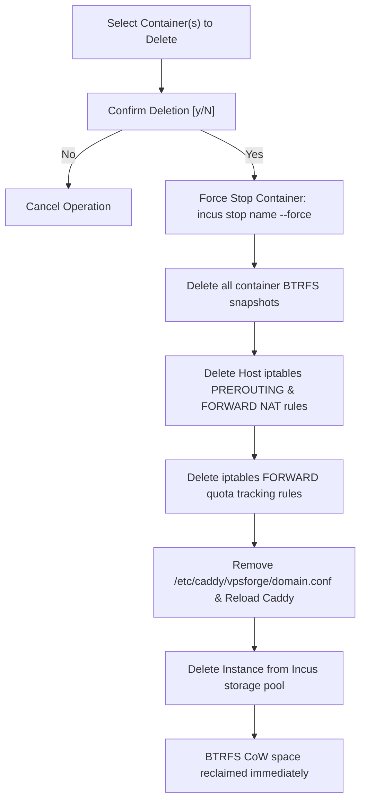

---

### 6.3 Container Reinstall & State Preservation (Menu 6)
Reinstall wipes the OS completely while guaranteeing zero metadata loss:

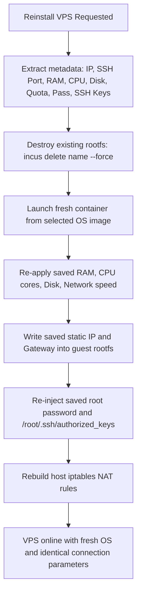

---

### 6.4 Resource Tuning & Live Modifications (Menu 7)
Modify any hardware resource without reinstalling:

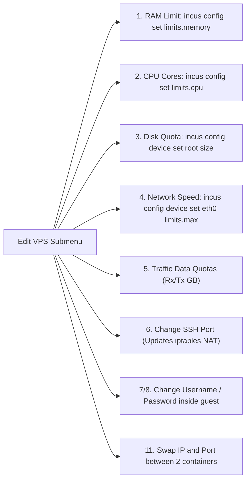

---

### 6.5 Port Forwarding & Conflict Detection (Menu 11)
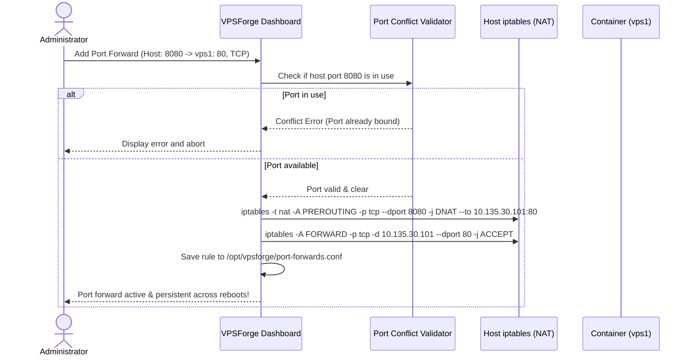

---

### 6.6 Domain Reverse Proxy & Auto-SSL via Caddy (Menu 12)
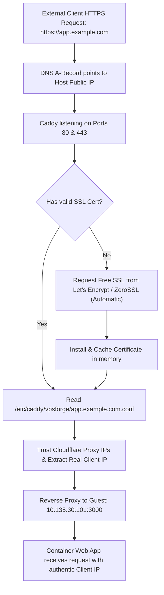

---

### 6.6b Sites from MY computer: reverse tunnels (Menu 12 > 4)
Your PC has no public address and the router blocks incoming connections. A reverse tunnel solves it: the PC opens a connection **out** to a VPS (allowed everywhere), and the server sends visitors back through it.


**Steps (menu 12 > 4 > Add a tunnel):** choose the VPS, the port to open on the VPS and the port of your site on the PC, then either a **domain** (HTTPS by Caddy) or a **public port** on the server. Then pick your computer:

| Choice | What you get |
|---|---|
| Windows | One line + a password. Paste it once in PowerShell: it installs the key, a hidden auto-start task and a desktop icon (window with On / Off / Delete and the current state). |
| Linux / macOS | A one-line loop that reconnects by itself. |
| More | Try once, create a **new key** (takes access back), or remove a Windows setup. |

**Who can do what.** The line and password belong to a limited login that exists only for that tunnel port. It cannot open a shell, cannot open any other port and cannot reach other services in the VPS, so it is safe to hand to a friend whose site cannot be exposed otherwise. Cloud firewalls (Oracle VCN, Google VPC) are yours: open the public TCP port there yourself.

**Manage them** in *My tunnels*: one table with each tunnel's state (`ACTIVE - connected`, `ACTIVE - waiting for your PC`, `STOPPED`), and start / stop / edit / delete for one tunnel or for all tunnels of a VPS.

---

### 6.6c VPN: Xray VLESS + Reality (Menu 12 > 5)

Turn a VPS into a VPN for your phones and computers. All their internet goes out through the VPS (its IP, its speed), and to anyone watching it looks like a normal HTTPS visit to `www.speedtest.net` (a stranger who connects to the port really gets speedtest.net).

**Create (12 > 5 > 1):** pick a running VPS and a public port (default 8443). Open **TCP <port>** (the VPN) and **TCP <port>+1** (the QR page) in your cloud firewall. Xray is downloaded from its official GitHub release (checksum checked) and runs as the `vpsforge-vpn` service inside the VPS.

**Add a device (12 > 5 > 2):** a name (e.g. `my-phone`), a **data limit in GB** and a **number of days** (0 = unlimited for either). The device is switched off by itself when one runs out (checked every 5 minutes); **Renew (12 > 5 > 4)** gives it new GB / days from today. The overview shows each device's use (`3.2/50 GB`), days left and whether it is in use.

**Connect:** the free apps **v2rayNG** (Android), **Streisand** or **V2Box** (iPhone), **v2rayN** (Windows). Choose one of:
- **QR page** (easiest): a link like `http://SERVER:8444/<secret>/` that shows the QR code and a *Copy link* button for 10 minutes, then closes (even if a browser keeps a connection open).
- **QR code** in the terminal, or the `vless://` **link** to paste (*Import from clipboard*).

The app shows the name `<server IP>-<VPS>-<days>-<GB>` by itself, e.g. `193.122.84.156-vps3-30d-50GB` (`unl` = unlimited).

**Speed:** measured from Frankfurt to a 1-CPU ARM VPS in Jeddah with Ookla speedtest: about **410 Mbit/s down / 570 up**, against 138 / 310 with WireGuard (the server's single CPU is at 100%: more CPUs give more speed). Normal HTTPS browsing needs even less CPU (Xray's *Vision* passes already-encrypted data through without encrypting it twice).

**Clean:** removing a device stops it at once; removing the VPN (12 > 5 > 6) removes Xray, its service and files from the VPS and its port from the server. Deleting the VPS or `vpsforge uninstall` remove everything too.

---

### 6.7 Snapshots & Compressed Backups (Menu 13)
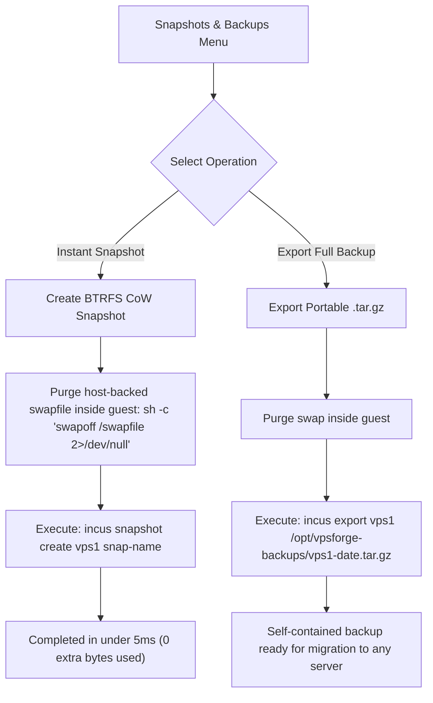

---

## 7. ⚙️ Engineering Secrets & Core Algorithms

### 7.1 BTRFS Copy-on-Write & Instant Snapshots
Standard directory storage (`dir`) copies every byte sequentially during snapshots, taking minutes and causing heavy disk I/O. VPSForge forces **BTRFS Copy-on-Write (CoW)**:

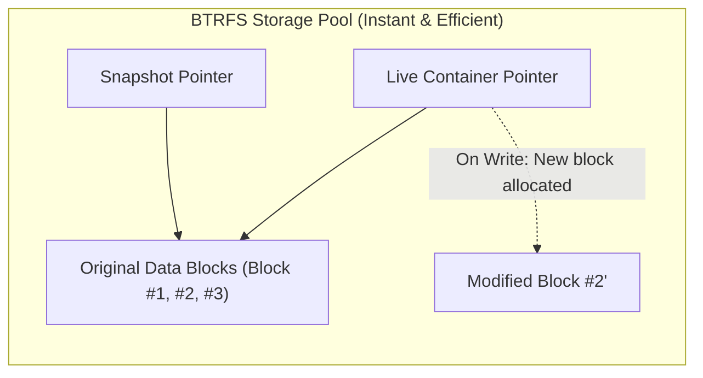

---

### 7.2 Automated Live Storage Migration
If an existing server has containers running on the default `dir` storage driver, VPSForge automatically migrates them to BTRFS without losing containers or configurations:

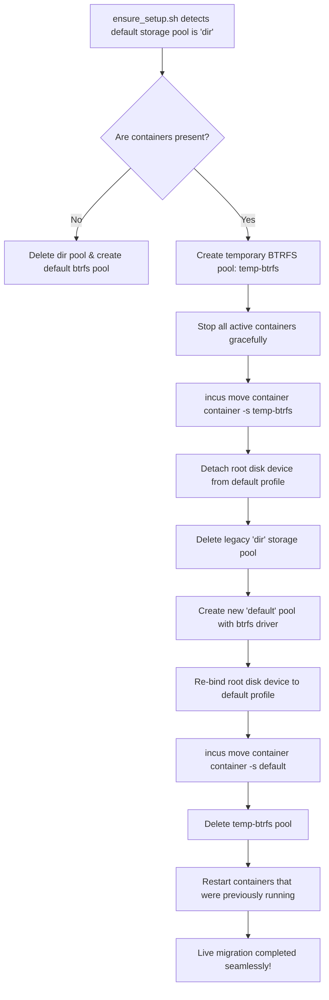

---

### 7.3 Network Traffic Quota Daemon & TC Throttling
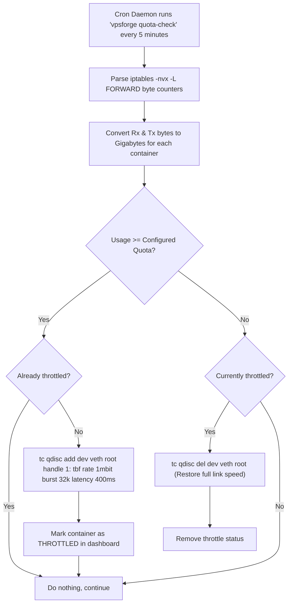

---

### 7.4 SSH 1-Click Repair & Native LXC Container Architecture
Incus system containers run full-system init (`systemd` as PID 1). Rather than using artificial container markers (such as legacy `/.dockerenv`), VPSForge operates on native LXC virtualization detection (`systemd-detect-virt` -> `lxc`).

When guest connectivity or service issues occur, 1-Click Repair restores network interfaces, DNS, and SSH services transparently:

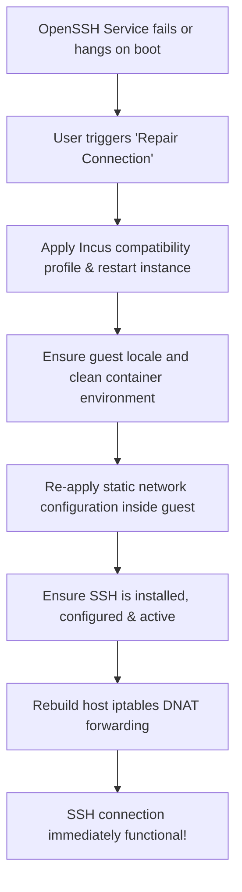

---

### 7.5 In-Place Auto-Update & Version Switcher
VPSForge enforces a **Single Source of Truth** architecture with atomic synchronization between the canonical Git repository (`/opt/vpsforge/repo`) and the active production runtime (`/opt/vpsforge`):

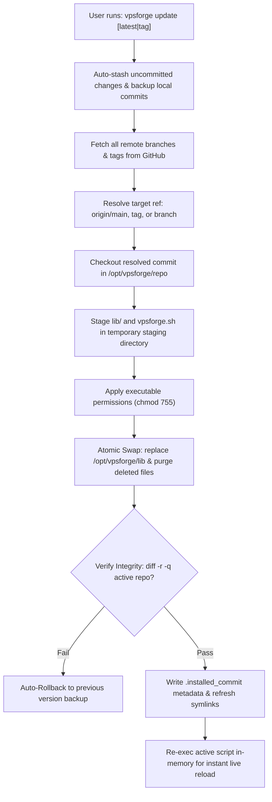

---

## 8. 📂 Project File Directory & Module Structure

**Rule: every function lives in its own file, named after the function, inside a folder named after its topic.**
`lib/load_vpsforge_lib.sh` (`load_vpsforge_lib`) sources every file under `lib/`, so folders can be reorganized freely.

```
vpsforge.sh                  # Entry point & CLI dispatcher
install.sh                   # Installer (records the server's original state first)
release.sh                   # Git release tagging script
scripts/
  check.sh                   # bash -n on every script + one-function-per-file rule
  test.sh                    # Offline unit tests (no root / incus needed)
  e2e.sh                     # End-to-end test of every feature on a real VPS (root)
  space-test.sh              # Measures real disk use of snapshots/backups/deleted VPSs
lib/
  load_vpsforge_lib.sh                  # load_vpsforge_lib: loads constants, then every function file
  core/
    common/                  # constants, small helpers (pause, ram_mb, is_valid_username)
    vps/                     # create/ guest/ image/ network/ user/ ssh_port/ state/ preserve/ profile/ reinstall/ repair/
    network/                 # host/ ip/ guest/ ssh/
    firewall/                # rules/ persistence/ bulk/ display/ isolation/ metadata/
    resources/               # cpu/ ram/ disk/ network/ traffic/ host/ allocation/ device/
    selection/               # interactive/ numbering/ parser/
    setup/                   # install/ storage/ compat/ kernel/ update/ preinstall/
    proxy/caddy/             # Caddy install, validate-or-rollback, IP follow, conflict checks
    backups/                 # list / delete / clean orphaned backups
    incus/                   # keeps Incus healthy: pause updates, self-test, online repair
    uninstall/               # vpsforge uninstall: puts the server back as it was
  dashboard/
    main/                    # dashboard table + main loop
    1-add ... 14-settings/   # numbered menus; actions grouped in sub-folders (menu/, actions/, selection/ ...)
    dashboard_helper.py      # Python helper that builds the stats table
```

### Keeping the host clean
- Deleting a VPS removes its snapshots, offers to delete its backups, removes its firewall rules and proxy config, and returns the freed space to the real disk (`reclaim_pool_space`; also automatic every Sunday).
- `vpsforge uninstall` removes containers, snapshots, backups, the storage pool, bridge, firewall rules, proxy configs, cron/system files and VPSForge itself, and restores `ip_forward`. It also purges the packages VPSForge installed (using the record in `/opt/vpsforge/.pre_install`). Use `--dry-run` to preview, `--keep-backups` to keep backups.
- `vpsforge tidy` additionally empties the apt cache, trims the system journal (200 MB cap), removes old kernels and deletes damaged backups. It also runs by itself every week (cron).

---

## 9. 🧠 AI / Developer System Reconstruction Guide

If you are an AI assistant or software engineer tasked with building a similar hypervisor manager from scratch, adhere to this exact blueprint:

1. **Choose Incus over Docker:** Docker is containerized process management; Incus provides complete system init containers with persistent networking, custom kernels/modules, and systemd daemons.
2. **Mandate BTRFS or ZFS Storage:** Directory storage (`dir`) is unusable for production hypervisors due to linear disk copy times. Loopback BTRFS image files (`size=25GiB`) provide instant Copy-on-Write branching without requiring dedicated disk partitions.
3. **Deterministic Networking:** Disable DHCP clients inside guest images; write static YAML (Netplan) or interfaces files into the container's rootfs before starting it.
4. **Calculated Port Offsets:** Establish fixed port formulas (`SSH = 9000 + ID`) to eliminate collision tracking complexity.
5. **Real-Time Traffic Accounting with Netfilter:** Place dummy matching rules (`-m comment --comment "vpsforge-quota-$name"`) inside the `FORWARD` table to use Linux's hardware packet counters as a free, high-speed telemetry engine.
6. **Token Bucket Filter (TBF) for Throttling:** Never hard-kill containers exceeding bandwidth quotas; shape their `veth` interface using `tc qdisc` to 1Mbps to keep management SSH channels alive.
7. **Caddy Reverse Proxy Automation:** Use Caddy's `import /etc/caddy/conf.d/*.conf` pattern for atomic, zero-downtime subdomain routing and automated SSL certificate lifecycles.

---

## 10. 💻 CLI Command Reference

Automate VPSForge or integrate it with external billing systems and web control panels using the native CLI:

```bash
vpsforge                         # Launch the interactive terminal dashboard
vpsforge --version               # Check the current version
vpsforge list                    # View a formatted status table of all containers
vpsforge details <vps>           # Print detailed resource, port, proxy, and snapshot metadata
vpsforge start|stop|restart <vps>
vpsforge ram <vps> <MB>          # Set container RAM limit (e.g. vpsforge ram vps1 1024)
vpsforge snapshot <vps> <name>   # Create an instantaneous snapshot
vpsforge backup <vps>            # Export a full self-contained backup (zstd compressed)
vpsforge clone <vps> [new]       # Instant exact copy of a VPS (own IP and SSH port)
vpsforge clean-backups           # List and delete backups whose VPS no longer exists
vpsforge reclaim                 # Give space freed inside the VPS pool back to the real disk
vpsforge tidy                    # reclaim + empty apt cache + trim system logs
vpsforge quota-check             # Manually execute the traffic quota verification daemon
vpsforge repair-all              # Rebuild all guest static network configs and SSH rules
vpsforge port-forward            # Port-forwarding CLI (add / delete / list ...)
vpsforge setup                   # Force the full host setup again
vpsforge update [latest|vX.Y.Z]  # Update from GitHub (or switch to a tagged release); --check / --list
vpsforge selftest                # Check that the Incus commands VPSForge needs still work (run after an Incus update)
vpsforge incus status|pin|unpin|repair   # Incus version, pause/allow its updates, repair it
vpsforge uninstall               # Remove everything; --dry-run, --yes, --keep-backups
```

---

## 📄 License

VPSForge is open-source software licensed under the [MIT License](LICENSE).
